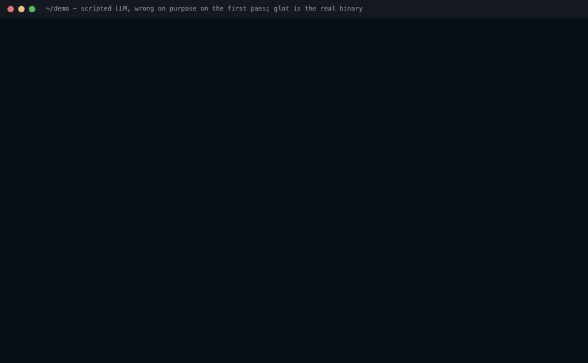

# glot

**Your coding agent localizes your app. Deterministic code guarantees that nothing broken or too long lands in your catalogs.**



<sub>The real `glot translate` binary. The LLM is scripted to get three strings wrong on its first pass; every refusal and message is glot's. Reproduce it, or rerun it with a real model doing the retries: [`docs/launch/record/refusal.sh`](docs/launch/record/refusal.sh).</sub>

```sh
npx glot-i18n init        # detect your i18n stack, write glot.toml + rules for your coding agent
npx glot-i18n i18nize     # hardcoded UI strings -> keys, components rewritten (next-intl, react-i18next)
npx glot-i18n translate   # translate only the delta; invalid output is refused, retried, never written
```

Or all of it in one idempotent step: `npx glot-i18n localize --yes --targets fr,de` (init if needed → i18nize → translate → check).

## Guarantees

Checked by code on every LLM output, on `glot set`, in the overlay and in CI (`glot check`). A refused string goes back to the model with the exact reason (2 retries, then the fallback model); if it still fails, nothing is written.

| | |
|---|---|
| **Placeholders** | `{name}`, `{{name}}`, tags: same set as the source, none invented, none translated. ICU, i18next and MessageFormat 2 syntax parsed. |
| **CLDR plurals** | Every category the target locale needs (`pl`: one, few, many, other; `ar`: six of them). |
| **Glossary** | `glossary.toml` in your repo: required and forbidden translations, do-not-translate terms. |
| **Pixel width** | `glot measure` records each key's box and font from your running app; translations are shaped with that font and refused if wider. `glot fit` shortens what already overflows. |
| **Lockfile** | `glot.lock` hashes source and target: only the delta is translated, and a hand edit is never overwritten without `--force`. |
| **MCP for your agent** | `glot mcp` gives Claude Code, Cursor or Codex your keys, their usages (file:line, UI role), the glossary, and tools that add strings through the same validator. |

Works with the i18n library you already use, adds no runtime, bring your own LLM key (Anthropic, OpenAI, any OpenAI-compatible endpoint). MIT.

**More:** [Docs](web/content/docs/getting-started.md) ([concepts](web/content/docs/concepts.md), [CLI](web/content/docs/cli.md), [MCP](web/content/docs/mcp.md), [integrations & GitHub Action](web/content/docs/integrations.md), [agent skill](web/content/docs/skills.md), [AI-translation provenance](web/content/docs/provenance.md), [FAQ & costs](web/content/docs/faq.md)) · [Labs](web/content/docs/labs.md) (SEO, database content, emails/images, task parity, plural coverage…) · [Self-hosted server (experimental)](web/content/docs/self-hosting.md) · [Demo app](examples/demo.sh) · [Architecture](ARCHITECTURE.md)
