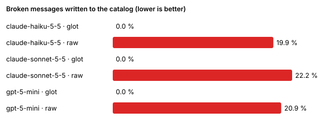

# glot-bench — mock-check

**Broken** = written to the catalog and failing glot's validator (ICU syntax, placeholders, CLDR plural categories, keywords, tags, glossary, pixel width) or the independent FormatJS + `Intl.PluralRules` judge. **Rejected** = refused by glot after retries/escalation and left untranslated instead of shipped broken (raw prompts never reject).

## Summary (all locales)

| Model | Condition | Messages | Broken | Broken (independent judge) | Rejected | Cost |
|---|---|---:|---:|---:|---:|---:|
| claude-haiku-5-5 | glot | 4000 | 0.0 % | 0.0 % | 3.6 % | $0.0000 |
| claude-haiku-5-5 | raw | 4000 | 19.9 % | 13.7 % | 0.0 % | $0.0000 |
| claude-sonnet-5-5 | glot | 4000 | 0.0 % | 0.0 % | 5.0 % | $0.0000 |
| claude-sonnet-5-5 | raw | 4000 | 22.2 % | 16.6 % | 0.0 % | $0.0000 |
| gpt-5-mini | glot | 4000 | 0.0 % | 0.0 % | 3.8 % | $0.0000 |
| gpt-5-mini | raw | 4000 | 20.9 % | 15.4 % | 0.0 % | $0.0000 |

## Per locale

| Model | Locale | Condition | Broken | Rejected | Cost | Tokens in/out (cache read) | Calls | Latency/call |
|---|---|---|---:|---:|---:|---|---:|---:|
| claude-haiku-5-5 | ar | glot | 0.0 % | 4.0 % | $0.0000 | 83085/23580 (0) | 39 | 2 ms |
| claude-haiku-5-5 | ar | raw | 20.2 % | 0.0 % | $0.0000 | 26962/16618 (0) | 13 | 7 ms |
| claude-haiku-5-5 | de | glot | 0.0 % | 0.8 % | $0.0000 | 70700/13679 (0) | 37 | 1 ms |
| claude-haiku-5-5 | de | raw | 17.6 % | 0.0 % | $0.0000 | 26865/11659 (0) | 13 | 1 ms |
| claude-haiku-5-5 | es | glot | 0.0 % | 4.0 % | $0.0000 | 80350/17645 (0) | 39 | 1 ms |
| claude-haiku-5-5 | es | raw | 20.2 % | 0.0 % | $0.0000 | 26871/12918 (0) | 13 | 1 ms |
| claude-haiku-5-5 | fr | glot | 0.0 % | 4.0 % | $0.0000 | 80860/17685 (0) | 39 | 2 ms |
| claude-haiku-5-5 | fr | raw | 20.4 % | 0.0 % | $0.0000 | 26891/12924 (0) | 13 | 2 ms |
| claude-haiku-5-5 | ja | glot | 0.0 % | 4.0 % | $0.0000 | 79081/13846 (0) | 39 | 1 ms |
| claude-haiku-5-5 | ja | raw | 20.2 % | 0.0 % | $0.0000 | 26953/10578 (0) | 13 | 2 ms |
| claude-haiku-5-5 | pl | glot | 0.0 % | 4.0 % | $0.0000 | 81129/19561 (0) | 39 | 1 ms |
| claude-haiku-5-5 | pl | raw | 20.2 % | 0.0 % | $0.0000 | 26857/14098 (0) | 13 | 2 ms |
| claude-haiku-5-5 | ru | glot | 0.0 % | 4.0 % | $0.0000 | 81527/19666 (0) | 39 | 2 ms |
| claude-haiku-5-5 | ru | raw | 20.2 % | 0.0 % | $0.0000 | 26979/14199 (0) | 13 | 3 ms |
| claude-haiku-5-5 | zh | glot | 0.0 % | 4.0 % | $0.0000 | 78679/13744 (0) | 39 | 1 ms |
| claude-haiku-5-5 | zh | raw | 20.2 % | 0.0 % | $0.0000 | 26826/10485 (0) | 13 | 1 ms |
| claude-sonnet-5-5 | ar | glot | 0.0 % | 5.4 % | $0.0000 | 76190/22422 (0) | 33 | 1 ms |
| claude-sonnet-5-5 | ar | raw | 22.6 % | 0.0 % | $0.0000 | 26962/16618 (0) | 13 | 2 ms |
| claude-sonnet-5-5 | de | glot | 0.0 % | 2.2 % | $0.0000 | 68138/13779 (0) | 33 | 1 ms |
| claude-sonnet-5-5 | de | raw | 19.4 % | 0.0 % | $0.0000 | 26865/11659 (0) | 13 | 3 ms |
| claude-sonnet-5-5 | es | glot | 0.0 % | 5.4 % | $0.0000 | 74072/17007 (0) | 33 | 1 ms |
| claude-sonnet-5-5 | es | raw | 22.6 % | 0.0 % | $0.0000 | 26871/12918 (0) | 13 | 2 ms |
| claude-sonnet-5-5 | fr | glot | 0.0 % | 5.4 % | $0.0000 | 74511/17043 (0) | 33 | 1 ms |
| claude-sonnet-5-5 | fr | raw | 22.8 % | 0.0 % | $0.0000 | 26891/12924 (0) | 13 | 2 ms |
| claude-sonnet-5-5 | ja | glot | 0.0 % | 5.4 % | $0.0000 | 73065/13535 (0) | 33 | 1 ms |
| claude-sonnet-5-5 | ja | raw | 22.6 % | 0.0 % | $0.0000 | 26953/10578 (0) | 13 | 2 ms |
| claude-sonnet-5-5 | pl | glot | 0.0 % | 5.4 % | $0.0000 | 74645/18749 (0) | 33 | 2 ms |
| claude-sonnet-5-5 | pl | raw | 22.6 % | 0.0 % | $0.0000 | 26857/14098 (0) | 13 | 3 ms |
| claude-sonnet-5-5 | ru | glot | 0.0 % | 5.4 % | $0.0000 | 74981/18857 (0) | 33 | 1 ms |
| claude-sonnet-5-5 | ru | raw | 22.6 % | 0.0 % | $0.0000 | 26979/14199 (0) | 13 | 2 ms |
| claude-sonnet-5-5 | zh | glot | 0.0 % | 5.4 % | $0.0000 | 72730/13437 (0) | 33 | 1 ms |
| claude-sonnet-5-5 | zh | raw | 22.6 % | 0.0 % | $0.0000 | 26826/10485 (0) | 13 | 2 ms |
| gpt-5-mini | ar | glot | 0.0 % | 4.2 % | $0.0000 | 85261/23793 (0) | 40 | 1 ms |
| gpt-5-mini | ar | raw | 21.2 % | 0.0 % | $0.0000 | 26962/16618 (0) | 13 | 2 ms |
| gpt-5-mini | de | glot | 0.0 % | 1.0 % | $0.0000 | 72712/13867 (0) | 38 | 0 ms |
| gpt-5-mini | de | raw | 18.4 % | 0.0 % | $0.0000 | 26865/11659 (0) | 13 | 1 ms |
| gpt-5-mini | es | glot | 0.0 % | 4.2 % | $0.0000 | 82501/17879 (0) | 40 | 1 ms |
| gpt-5-mini | es | raw | 21.2 % | 0.0 % | $0.0000 | 26871/12918 (0) | 13 | 1 ms |
| gpt-5-mini | fr | glot | 0.0 % | 4.2 % | $0.0000 | 83011/17913 (0) | 40 | 1 ms |
| gpt-5-mini | fr | raw | 21.4 % | 0.0 % | $0.0000 | 26891/12924 (0) | 13 | 2 ms |
| gpt-5-mini | ja | glot | 0.0 % | 4.2 % | $0.0000 | 81269/14081 (0) | 40 | 1 ms |
| gpt-5-mini | ja | raw | 21.2 % | 0.0 % | $0.0000 | 26953/10578 (0) | 13 | 2 ms |
| gpt-5-mini | pl | glot | 0.0 % | 4.2 % | $0.0000 | 83309/19790 (0) | 40 | 1 ms |
| gpt-5-mini | pl | raw | 21.2 % | 0.0 % | $0.0000 | 26857/14098 (0) | 13 | 1 ms |
| gpt-5-mini | ru | glot | 0.0 % | 4.2 % | $0.0000 | 83718/19899 (0) | 40 | 1 ms |
| gpt-5-mini | ru | raw | 21.2 % | 0.0 % | $0.0000 | 26979/14199 (0) | 13 | 1 ms |
| gpt-5-mini | zh | glot | 0.0 % | 4.2 % | $0.0000 | 80859/13982 (0) | 40 | 1 ms |
| gpt-5-mini | zh | raw | 21.2 % | 0.0 % | $0.0000 | 26826/10485 (0) | 13 | 2 ms |

## Why messages broke

| Model | Condition | Issues (count) | Broken per category |
|---|---|---|---|
| claude-haiku-5-5 | glot | — | — |
| claude-haiku-5-5 | raw | glossary_violation 24, independent:placeholder_extra 168, independent:placeholder_missing 32, independent:plural_category_missing 36, independent:syntax_error 220, independent:tag_mismatch 95, keyword_translated 68, placeholder_extra 168, placeholder_missing 32, plural_category_missing 37, syntax_error 152, tag_mismatch 97, too_wide 256 | ambiguous 16, apostrophe 32, datenum 40, dnt 48, glossary 32, nested 123, placeholders 72, plural 72, plural_offset 24, select 56, selectordinal 9, tags 16, width 256 |
| claude-sonnet-5-5 | glot | — | — |
| claude-sonnet-5-5 | raw | glossary_violation 16, independent:placeholder_extra 168, independent:placeholder_missing 8, independent:plural_category_missing 42, independent:syntax_error 334, independent:tag_mismatch 112, keyword_translated 86, placeholder_extra 168, placeholder_missing 8, plural_category_missing 43, syntax_error 248, tag_mismatch 112, too_wide 256 | ambiguous 32, apostrophe 72, datenum 24, dnt 16, glossary 32, nested 144, placeholders 104, plural 80, plural_offset 24, select 48, selectordinal 1, tags 56, width 256 |
| gpt-5-mini | glot | — | — |
| gpt-5-mini | raw | glossary_violation 24, independent:placeholder_extra 216, independent:placeholder_missing 8, independent:plural_category_missing 48, independent:syntax_error 248, independent:tag_mismatch 106, keyword_translated 64, placeholder_extra 216, placeholder_missing 8, plural_category_missing 49, syntax_error 184, tag_mismatch 110, too_wide 248 | ambiguous 48, apostrophe 72, datenum 8, dnt 40, glossary 16, nested 122, placeholders 64, plural 64, plural_offset 24, select 48, selectordinal 41, tags 40, width 248 |
