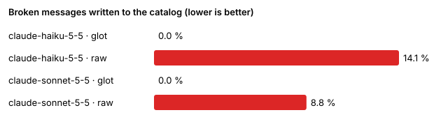

# Benchmark

Does the glot pipeline actually ship fewer broken strings than asking a model to "translate this JSON"? **glot-bench** measures it on a public evaluation set, with the same models on both sides, and a judge that is not glot's own code.

## The dataset

[`bench/data/messages.jsonl`](https://github.com/MattJeff/glot/blob/main/bench/data/messages.jsonl): 500 English UI messages written for the benchmark (CC0), modeled on patterns from open-source app catalogs (issue trackers, chat, billing, file sharing, CI dashboards). Each line has an `id`, a `category`, the `source`, a UI `description`, a `ui_role`, the glossary terms it uses and, for buttons and tabs, a pixel budget (`fit`).

| Category | Messages | What makes it hard |
|---|---:|---|
| `plural` | 88 | `#`, `=0`, sentences around the plural |
| `plural_offset` | 16 | `offset:1`, `=0`/`=1` with a nested `{name}` |
| `select` | 32 | gender, role and status selects with nested placeholders |
| `selectordinal` | 19 | English ordinals (`#st`, `#nd`) that other languages express differently |
| `nested` | 36 | select → plural, plural → rich tags |
| `placeholders` | 60 | 2 to 4 variables, `number`/`date`/`time` formats and skeletons |
| `tags` | 50 | `<b>`, `<link>`, `<kbd>`, `<code>`, custom tags, tags around plurals |
| `apostrophe` | 30 | ICU `''` escaping and `'{'` quoted braces |
| `glossary` | 33 | Workspace, Invoice, Project, Dashboard, Billing with mandatory translations |
| `dnt` | 30 | glot, GitHub, Slack, Stripe, Acme, OAuth, API, Markdown stay verbatim |
| `ambiguous` | 40 | "Save", "Close", "Archive", "Post", "Charge"… with their UI context (same text, different meaning) |
| `width` | 46 | buttons in 96–120 px at Inter 14 px/500, 80 px tabs, 2-line cards |
| `datenum` | 20 | currency, percent, compact and unit skeletons |

The glossary is [`bench/data/glossary.toml`](https://github.com/MattJeff/glot/blob/main/bench/data/glossary.toml). The set is generated by `bench/data/gen.py`, which deduplicates it. The 40 `ambiguous` strings keep repeated texts on purpose, since only the context differs.

Target locales: `fr`, `de`, `es`, `pl`, `ru`, `ar`, `ja`, `zh`. They cover 1 to 6 CLDR plural categories, a right-to-left script and two CJK languages.

## The two conditions

- **raw**: the prompt a developer would write. JSON in, JSON out. It asks the model to keep placeholders, ICU syntax and tags, and passes the glossary and each string's UI description. There is no validation and no retry. Everything the model returns is written.
- **glot**: the full `glot translate` pipeline with the same model. That means the system prompt with the target's CLDR plural categories and the glossary, the pixel budget per string, validation, two targeted retries, and escalation to a stronger model (`claude-haiku-5-5` → `claude-sonnet-5-5`, `gpt-5-mini` → `gpt-5`). A message that still fails is **rejected**: it is left untranslated instead of written broken.

## What counts as broken

A message is **broken** when it was written to the catalog and fails one of these checks:

1. **glot's validator** (`glot_core::validate`). It checks ICU syntax, lost or invented placeholders, missing CLDR plural categories, translated keywords, broken tags, the glossary and do-not-translate terms (inflected forms accepted), and the pixel width measured with the same font metrics as `glot check`.
2. **An independent judge** ([`bench/judge/icu-judge.mjs`](https://github.com/MattJeff/glot/blob/main/bench/judge/icu-judge.mjs)). It parses with FormatJS's `@formatjs/icu-messageformat-parser` (the parser behind `intl-messageformat` and react-intl) and takes the required plural categories from the JS engine's own CLDR data (`Intl.PluralRules`). It flags syntax errors, placeholder or tag drift, missing plural categories and translated select keys. Because of it, glot is not the only one grading glot.

The report shows both the combined rate and the independent-judge-only rate. It also reports **rejected** messages, cost, tokens (including prompt-cache reads), calls and latency per call for every (model, locale, condition).

The benchmark does not score meaning or fluency (there are no human reference translations). It measures what breaks a build or a screen.

## Reproduce

```sh
cd bench/judge && npm install && cd ../..                      # independent judge
export ANTHROPIC_API_KEY=… OPENAI_API_KEY=…
cargo run -p glot-bench -- run --sample 40 --budget-usd 3 --dry-run   # estimate only
cargo run -p glot-bench -- run --models claude-haiku-5-5,claude-sonnet-5-5,gpt-5-mini \
  --locales fr,de,es,pl,ru,ar,ja,zh --sample 40 --budget-usd 3
cargo run -p glot-bench -- report --docs web/content/docs/benchmark.md
```

- **Estimate first.** `run` prints the expected and worst-case cost of every cell before calling anything. It refuses to start if the expected total exceeds `--budget-usd`, and it stops calling the API once real spend reaches that cap.
- **Resumable.** Every paid answer is cached in `bench/cache/`, keyed by the exact request. Finished cells are skipped. Re-running the same command after an interruption costs nothing for the work already done.
- **Offline check.** `--mock` serves every model with the `mock-noisy` provider. It breaks a seeded share of answers the way models do: a lost or invented placeholder, a dropped plural branch, a translated keyword, a broken tag or brace (`GLOT_MOCK_SEED`, `GLOT_MOCK_NOISE`, default 15 %). Use it to verify the metrics end to end without a key.

Results land in `bench/results/<date>/`: `report.md`, `report.json`, `chart.svg` and the raw outputs per cell.

## Results

<!-- bench:results:start -->
_Run `bench/results/2026-10-18-real`._

**Broken** = written to the catalog and failing glot's validator (ICU syntax, placeholders, CLDR plural categories, keywords, tags, glossary, pixel width) or the independent FormatJS + `Intl.PluralRules` judge. **Rejected** = refused by glot after retries/escalation and left untranslated instead of shipped broken (raw prompts never reject).

### Summary (all locales)

| Model | Condition | Messages | Broken | Broken (independent judge) | Rejected | Cost |
|---|---|---:|---:|---:|---:|---:|
| claude-haiku-5-5 | glot | 320 | 0.0 % | 0.0 % | 1.9 % | $0.0847 |
| claude-haiku-5-5 | raw | 320 | 14.1 % | 11.9 % | 0.0 % | $0.0212 |
| claude-sonnet-5-5 | glot | 320 | 0.0 % | 0.0 % | 3.1 % | $0.5081 |
| claude-sonnet-5-5 | raw | 320 | 8.8 % | 7.5 % | 0.0 % | $0.2953 |



### Per locale

| Model | Locale | Condition | Broken | Rejected | Cost | Tokens in/out (cache read) | Calls | Latency/call |
|---|---|---|---:|---:|---:|---|---:|---:|
| claude-haiku-5-5 | ar | glot | 0.0 % | 0.0 % | $0.0078 | 8781/13683 (1152) | 3 | 19430 ms |
| claude-haiku-5-5 | ar | raw | 40.0 % | 0.0 % | $0.0026 | 4489/4246 (0) | 1 | 14488 ms |
| claude-haiku-5-5 | de | glot | 0.0 % | 0.0 % | $0.0039 | 5892/6417 (0) | 1 | 23674 ms |
| claude-haiku-5-5 | de | raw | 2.5 % | 0.0 % | $0.0026 | 4486/4160 (0) | 1 | 14111 ms |
| claude-haiku-5-5 | es | glot | 0.0 % | 5.0 % | $0.0164 | 11371/8036 (0) | 4 | 9604 ms |
| claude-haiku-5-5 | es | raw | 0.0 % | 0.0 % | $0.0024 | 4482/3763 (0) | 1 | 12662 ms |
| claude-haiku-5-5 | fr | glot | 0.0 % | 5.0 % | $0.0167 | 11712/9138 (0) | 4 | 10592 ms |
| claude-haiku-5-5 | fr | raw | 5.0 % | 0.0 % | $0.0024 | 4483/3826 (0) | 1 | 19435 ms |
| claude-haiku-5-5 | ja | glot | 0.0 % | 5.0 % | $0.0101 | 11029/7776 (0) | 4 | 9313 ms |
| claude-haiku-5-5 | ja | raw | 5.0 % | 0.0 % | $0.0025 | 4489/4073 (0) | 1 | 15098 ms |
| claude-haiku-5-5 | pl | glot | 0.0 % | 0.0 % | $0.0060 | 7792/10367 (0) | 2 | 21081 ms |
| claude-haiku-5-5 | pl | raw | 42.5 % | 0.0 % | $0.0026 | 4484/4237 (0) | 1 | 14569 ms |
| claude-haiku-5-5 | ru | glot | 0.0 % | 0.0 % | $0.0067 | 8286/11653 (0) | 2 | 25348 ms |
| claude-haiku-5-5 | ru | raw | 17.5 % | 0.0 % | $0.0038 | 4481/6563 (0) | 1 | 23724 ms |
| claude-haiku-5-5 | zh | glot | 0.0 % | 0.0 % | $0.0171 | 10947/6298 (0) | 4 | 7747 ms |
| claude-haiku-5-5 | zh | raw | 0.0 % | 0.0 % | $0.0023 | 4479/3713 (0) | 1 | 13502 ms |
| claude-sonnet-5-5 | ar | glot | 0.0 % | 5.0 % | $0.1087 | 9947/8651 (0) | 3 | 19337 ms |
| claude-sonnet-5-5 | ar | raw | 30.0 % | 0.0 % | $0.0630 | 4489/5328 (0) | 1 | 29222 ms |
| claude-sonnet-5-5 | de | glot | 0.0 % | 0.0 % | $0.0342 | 7318/1788 (0) | 2 | 5911 ms |
| claude-sonnet-5-5 | de | raw | 0.0 % | 0.0 % | $0.0271 | 4486/1731 (0) | 1 | 9632 ms |
| claude-sonnet-5-5 | es | glot | 0.0 % | 0.0 % | $0.0447 | 7733/2758 (0) | 2 | 9633 ms |
| claude-sonnet-5-5 | es | raw | 0.0 % | 0.0 % | $0.0250 | 4482/1529 (0) | 1 | 8894 ms |
| claude-sonnet-5-5 | fr | glot | 0.0 % | 5.0 % | $0.0739 | 10157/5131 (0) | 3 | 12248 ms |
| claude-sonnet-5-5 | fr | raw | 5.0 % | 0.0 % | $0.0284 | 4483/1862 (0) | 1 | 9811 ms |
| claude-sonnet-5-5 | ja | glot | 0.0 % | 5.0 % | $0.0371 | 9316/1616 (0) | 3 | 3861 ms |
| claude-sonnet-5-5 | ja | raw | 5.0 % | 0.0 % | $0.0235 | 4489/1371 (0) | 1 | 8423 ms |
| claude-sonnet-5-5 | pl | glot | 0.0 % | 5.0 % | $0.0886 | 9972/6636 (0) | 3 | 15904 ms |
| claude-sonnet-5-5 | pl | raw | 12.5 % | 0.0 % | $0.0553 | 4484/4559 (0) | 1 | 25396 ms |
| claude-sonnet-5-5 | ru | glot | 0.0 % | 5.0 % | $0.0805 | 10443/5734 (0) | 3 | 13912 ms |
| claude-sonnet-5-5 | ru | raw | 12.5 % | 0.0 % | $0.0506 | 4481/4088 (0) | 1 | 23757 ms |
| claude-sonnet-5-5 | zh | glot | 0.0 % | 0.0 % | $0.0403 | 7573/2350 (0) | 2 | 8804 ms |
| claude-sonnet-5-5 | zh | raw | 5.0 % | 0.0 % | $0.0223 | 4479/1256 (0) | 1 | 7618 ms |

### Why messages broke

| Model | Condition | Issues (count) | Broken per category |
|---|---|---|---|
| claude-haiku-5-5 | glot | — | — |
| claude-haiku-5-5 | raw | independent:plural_category_missing 32, independent:tag_mismatch 6, plural_category_missing 32, tag_mismatch 6, too_wide 7 | nested 10, placeholders 4, plural 16, plural_offset 2, tags 6, width 7 |
| claude-sonnet-5-5 | glot | — | — |
| claude-sonnet-5-5 | raw | independent:plural_category_missing 12, independent:tag_mismatch 14, plural_category_missing 12, tag_mismatch 14, too_wide 4 | nested 13, placeholders 2, plural 4, plural_offset 1, tags 4, width 4 |
<!-- bench:results:end -->
